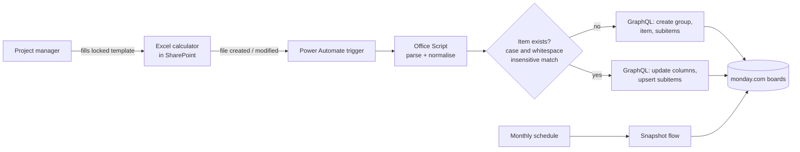

# Power Automate to monday.com Integration

**Two production Power Automate flows that move project value and client satisfaction (NPS) data from SharePoint and Excel into monday.com through its GraphQL API, replacing manual data entry for a project management office.**


> **Case study.** Built during my 2026 co-op term at Black & McDonald. The flows, scripts, boards and data belong to the company and are not published.
> This repository explains the design and the debugging, with **generic examples** (`examples/`) written for this write-up that show the techniques without any company configuration.

## At a glance

| | |
|---|---|
| **Users** | Project Management Office (PMO) leads and project managers |
| **Flow 1: Value Assurance** | 18 actions: SharePoint trigger, Office Script parses a locked Excel template, then a GraphQL upsert of a group, main item and one subitem per benefit |
| **Flow 2: Monthly Snapshots** | 9 actions: records a monthly snapshot for trend reporting |
| **Mapping** | 17 columns across 4 boards, API version pinned |
| **Template** | Locked Excel calculator: 37 formulas, 141 editable cells, 13 data validations, 4 tabs |
| **Docs** | 15-page runbook and a 2-page board structure memo |
| **Status** | NPS flow live and verified; value flow transitioned with the runbook |

## How it works



Details: [docs/flow-design.md](docs/flow-design.md).

## Engineering decisions

| Decision | Alternatives rejected | Why |
|---|---|---|
| Raw GraphQL over HTTP | The paid monday connector | The connector was not available on the licence. GraphQL gave full control over upserts and subitems. |
| Subitems per benefit | One flat item per row | Keeps one project as one item with its benefits underneath, which matches how the PMO reads the board. |
| monday.com as the source of truth | An archive folder of past files | One place to look; history kept by the snapshot flow instead of by files. |
| Lock the Excel template | Validating bad input inside the script | Making bad input impossible at the source beats catching it later: 13 validations and 141 editable cells, everything else protected. |
| NPS scoring inside the flow | Using monday formula columns | monday formula columns return null through the API. I proved this with 33 NPS items that all came back blank, then reimplemented promoter, passive and detractor scoring as flow expressions ([example](examples/nps-scoring.md)). |
| Pin the API version | Always latest | Prevents silent breaking changes in a production flow. |

## The best bug: a 400 on a valid request

The flow got `400: query must be provided` on a request body that was clearly valid. Instead of rewriting the query, I isolated variables one at a time:

1. Sent the smallest possible query, `{ me { name } }`. **Still failed**, which ruled out the query itself.
2. Ran the same query with the same token in the API playground. **Worked**, which ruled out the token and permissions.
3. That left the HTTP request itself. A trailing newline inside the `Authorization` header value was breaking the request framing, and the server never saw the body.

Full write-up: [docs/debugging-the-400.md](docs/debugging-the-400.md).

## Repository contents

```
docs/
  flow-design.md           both flows, action by action, and the idempotent upsert
  debugging-the-400.md     the isolation steps for the header newline bug
examples/
  upsert-item.graphql      generic GraphQL upsert pattern for an item and subitems
  nps-scoring.md           NPS classification and score as flow expressions
```

## Tech

Power Automate (cloud flows, HTTP actions, expressions, scheduled triggers), monday.com GraphQL API, Office Scripts (TypeScript), Excel (protected templates, data validation), SharePoint.

## How this was built

I use Claude as a working part of my development process. On this project I owned the flow design, all platform configuration, every test run and the production debugging, including each isolation step in the header bug. Claude drafted Power Automate expressions, Office Script code and documentation under my direction, and I reviewed and tested each change. This write-up was also drafted with Claude.
